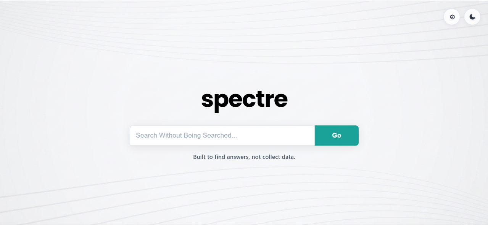
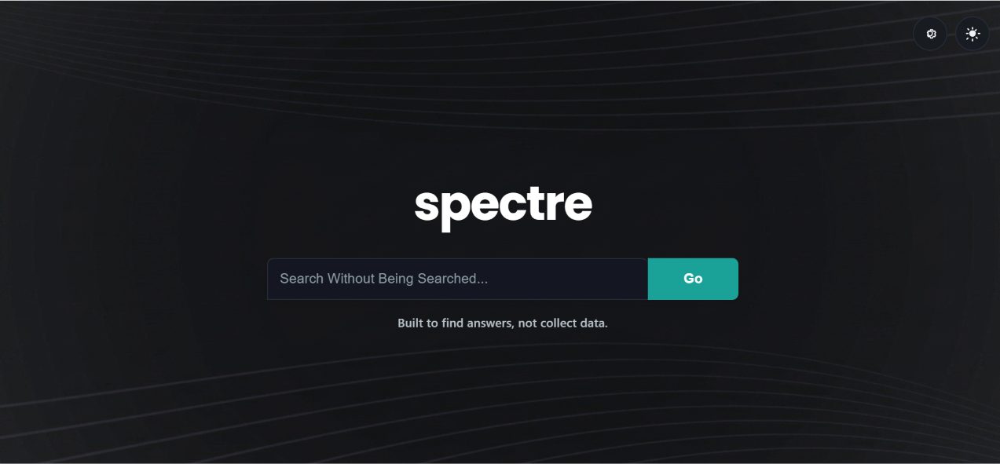

  
   

 ### ***Search the web privately with no tracking.***

---
<!-- -->

---

Spectre Search is a lightweight, privacy-focused search tool designed to deliver clean results and instant answers. Built for speed and minimalism, it gives you a fast, clutter-free search experience with your privacy in mind.

---

## Screenshots

### Light theme:
  

## Dark Theme:
 

---

## ⚙️ How It Works

* **DuckDuckGo Data Fetching:** Search queries are sent to DuckDuckGo to retrieve web results.
* **Groq AI Overviews:** When AI overviews are enabled, questions and search-result snippets are sent to Groq to generate summaries and answers.
* **Custom HTML/CSS UI:** A clean, lightweight interface with responsive layouts and dark/light mode.

---

> [!NOTE]
> To show web results, our server sends your query to DuckDuckGo.
>
> You can turn off AI Overviews in Settings; searches will still return web links, but your question and result snippets won't be sent to Groq for an overview.
>
>  When AI Overviews are on, your question and up to four result snippets are sent to Groq. Search history and Ask conversations are stored in your browser's localStorage, not in a Spectre account. Our hosting provider also handles requests; each provider follows its own privacy practices.
---
## Feedback & Support

Found a bug or have a feature request? Please [open an issue](https://github.com/WavierPigeon261/spectre-search/issues). Before creating a new issue, please check the existing ones to see if your topic has already been discussed.

---
